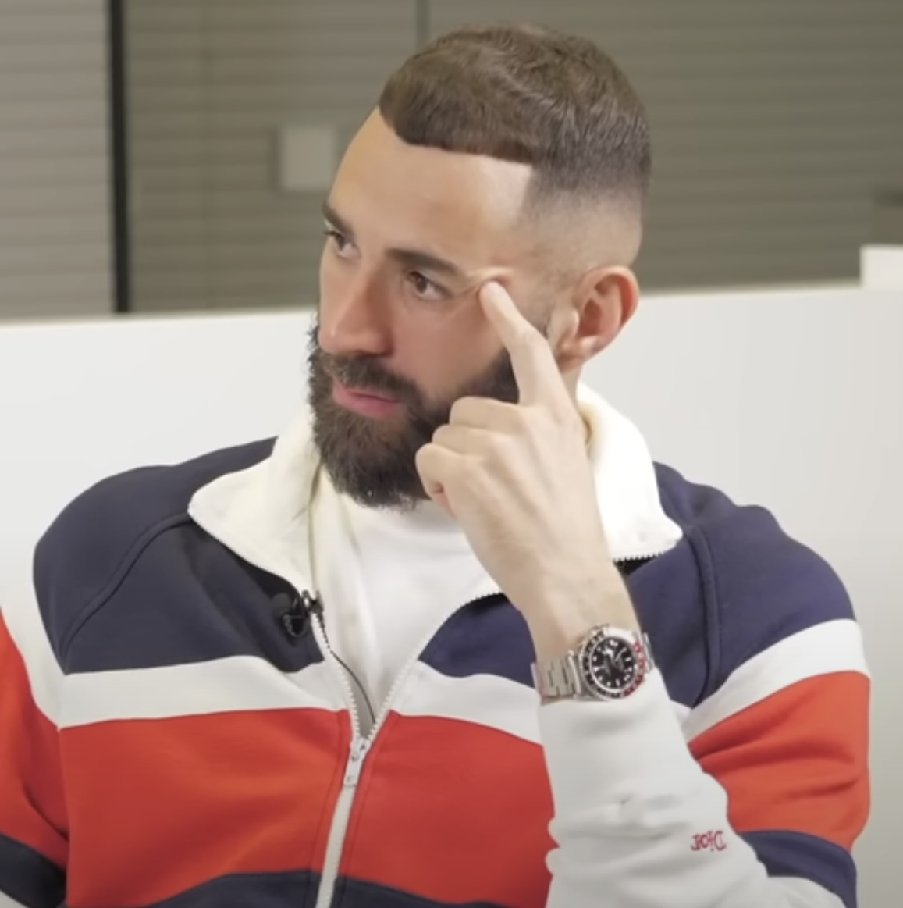
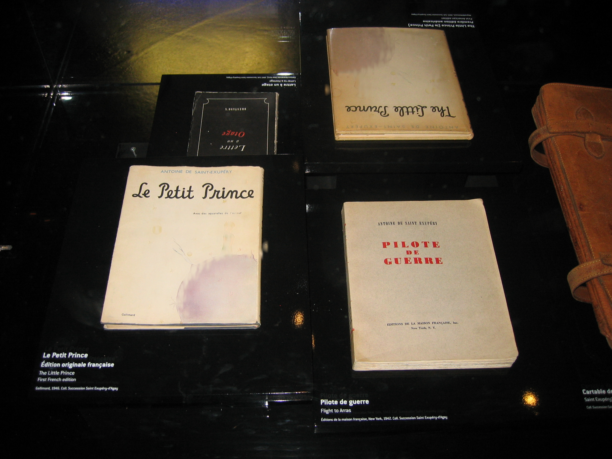
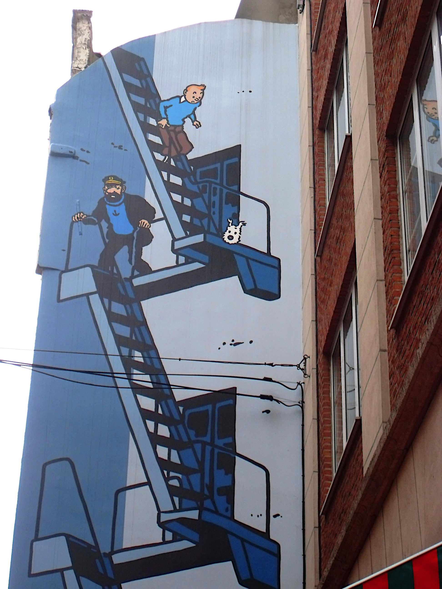
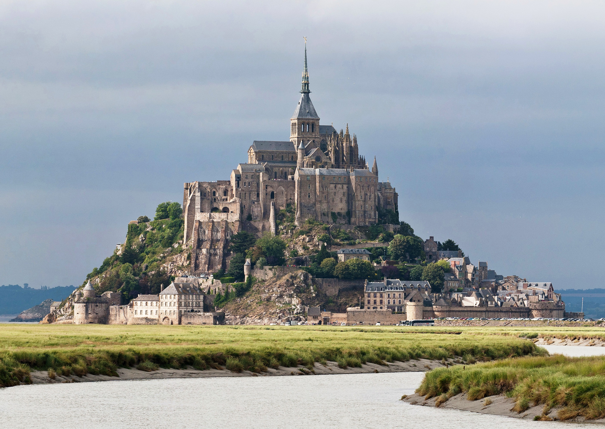
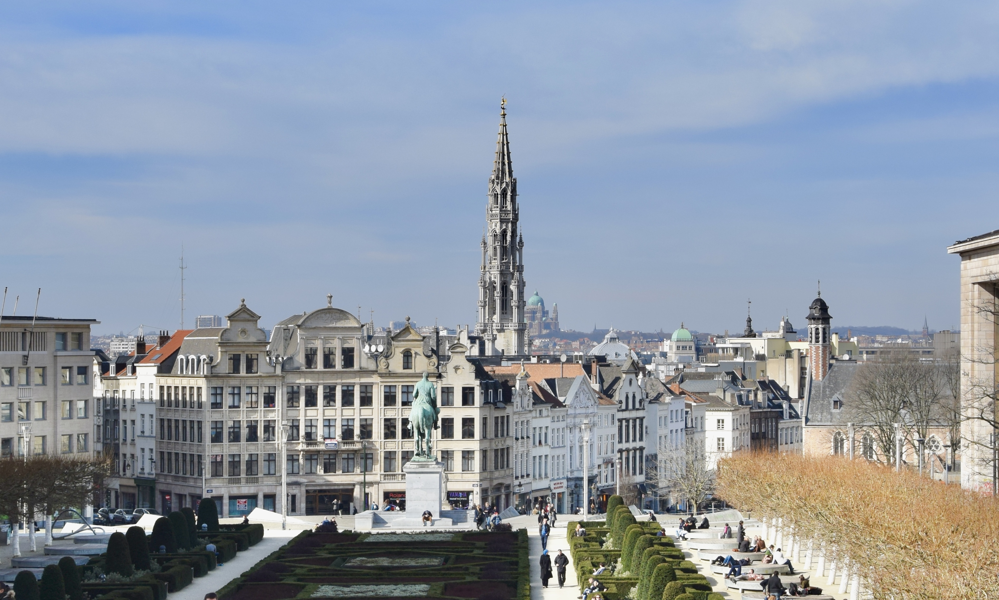

# Rejected Images Sample

**Date:** 2026-10-21T16:25:44.148Z

**Purpose:** Visual verification of validation logic

**Note:** These images were rejected by the automated validation. Review them to confirm if the rejection was correct.

---

## Karim Benzema (Q1912)

**Rejection reason:** Bad pattern: map

**Source URL:** [Wikidata](https://wikidata.org/wiki/Q1912)

**Image URL:** http://commons.wikimedia.org/wiki/Special:FilePath/Karim%20Benzema%20Pick.jpg

**Decision:** 🤔 Review this image — was the rejection correct?

---

## Le Petit Prince (Q25338)

**Rejection reason:** No matches - exhibit photo

**Source URL:** [Wikidata](https://wikidata.org/wiki/Q25338)

**Image URL:** http://commons.wikimedia.org/wiki/Special:FilePath/Saint%20Exupery%20exhibit%20-%20Air%20%26%20Space%20Museum%2C%20Le%20Bourget%2C%20Paris%2C%20France%2C%20absent%20artwork%20and%20not%20subject%20to%20copyright.jpg

**Decision:** 🤔 Review this image — was the rejection correct?

---

## ❌ Intouchables (Q595)

**Rejection reason:** No image found

**Status:** No image available on Wikidata (P18, P154, P491)

---

## Les Aventures de Tintin (Q744536)

**Rejection reason:** Comic mural (not character)

**Source URL:** [Wikidata](https://wikidata.org/wiki/Q744536)

**Image URL:** http://commons.wikimedia.org/wiki/Special:FilePath/Comic%20Mural%20Tintin%2C%20Herg%C3%A9%2C%20Brussels.jpg

**Decision:** 🤔 Review this image — was the rejection correct?

---

## ❌ France (Q142)

**Rejection reason:** Generic Paris view

**Status:** Rate limit (429) - Image exists but not downloaded

**Image URL:** http://commons.wikimedia.org/wiki/Special:FilePath/Paris%20from%20the%20Arc%20de%20Triomphe%2C%2017%20October%202019.jpg

---

## Le Mont-Saint-Michel (Q20892)

**Rejection reason:** Score 15/100 (under threshold)

**Source URL:** [Wikidata](https://wikidata.org/wiki/Q20892)

**Image URL:** http://commons.wikimedia.org/wiki/Special:FilePath/Mont%20St%20Michel%203%2C%20Brittany%2C%20France%20-%20July%202011.jpg

**Decision:** 🤔 Review this image — was the rejection correct?

---

## Suisse (Q39)

**Rejection reason:** Swiss gov logo (not flag)

**Source URL:** [Wikidata](https://wikidata.org/wiki/Q39)

**Image URL:** http://commons.wikimedia.org/wiki/Special:FilePath/Logo%20der%20Schweizerischen%20Eidgenossenschaft.svg

**Decision:** 🤔 Review this image — was the rejection correct?

---

## Canada (Q16)

**Rejection reason:** Location map

**Source URL:** [Wikidata](https://wikidata.org/wiki/Q16)

**Image URL:** http://commons.wikimedia.org/wiki/Special:FilePath/Canada%20-%20Location%20Map%20%282013%29%20-%20CAN%20-%20UNOCHA.svg

**Decision:** 🤔 Review this image — was the rejection correct?

---

## Bruxelles (Q239)

**Rejection reason:** Generic city view

**Source URL:** [Wikidata](https://wikidata.org/wiki/Q239)

**Image URL:** http://commons.wikimedia.org/wiki/Special:FilePath/Brussels%20view%20from%20Mont%20des%20Arts%2C%20Brussels%2C%20Belgium%20%28cropped%29.jpg

**Decision:** 🤔 Review this image — was the rejection correct?

---

